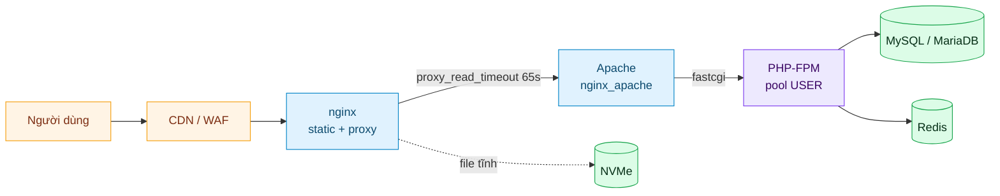
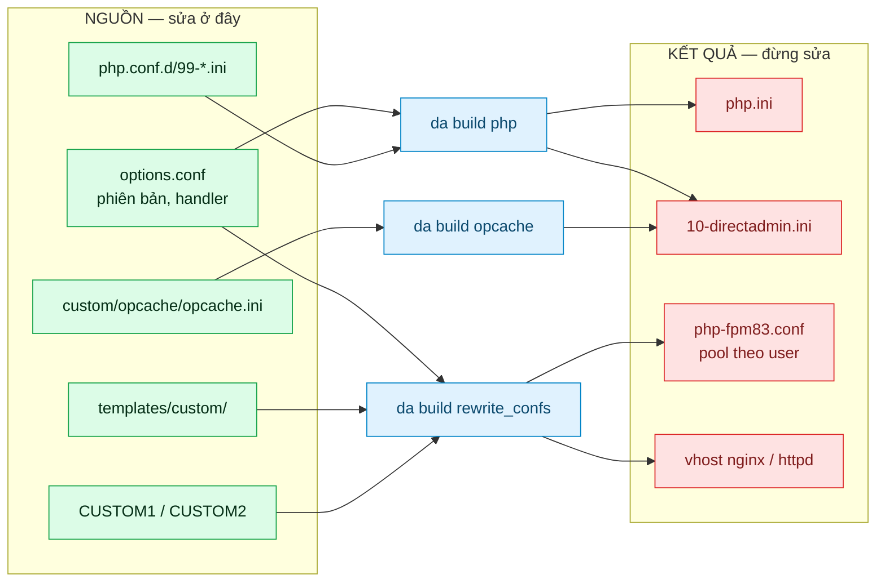
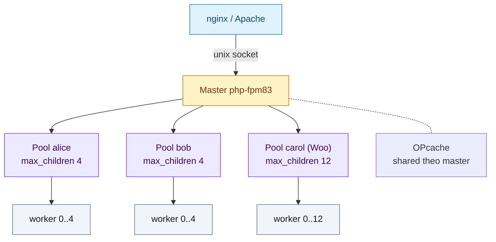
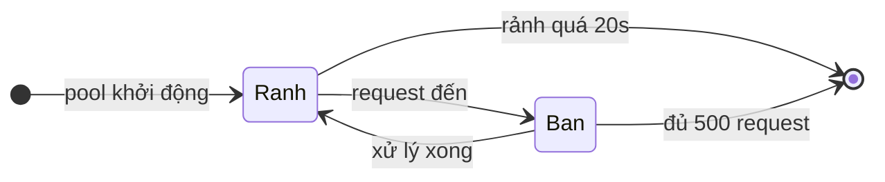
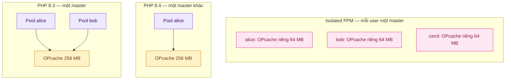
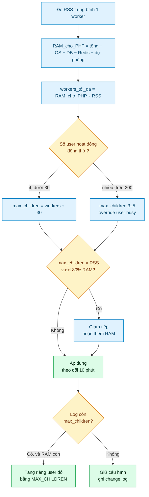
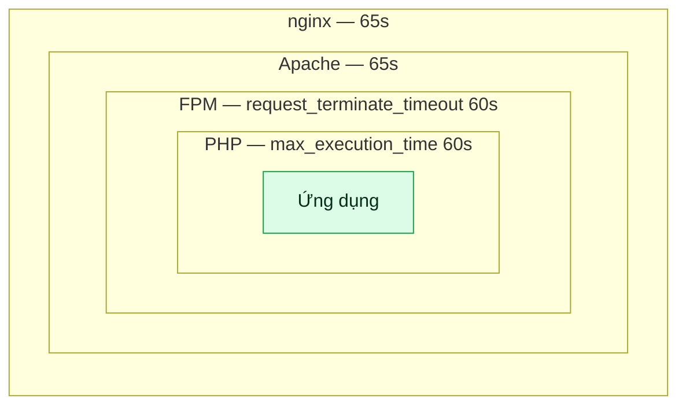
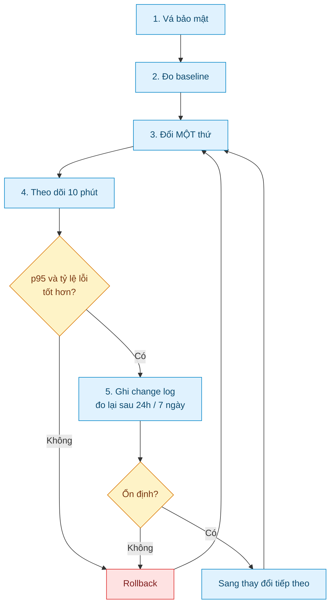
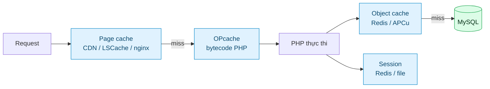
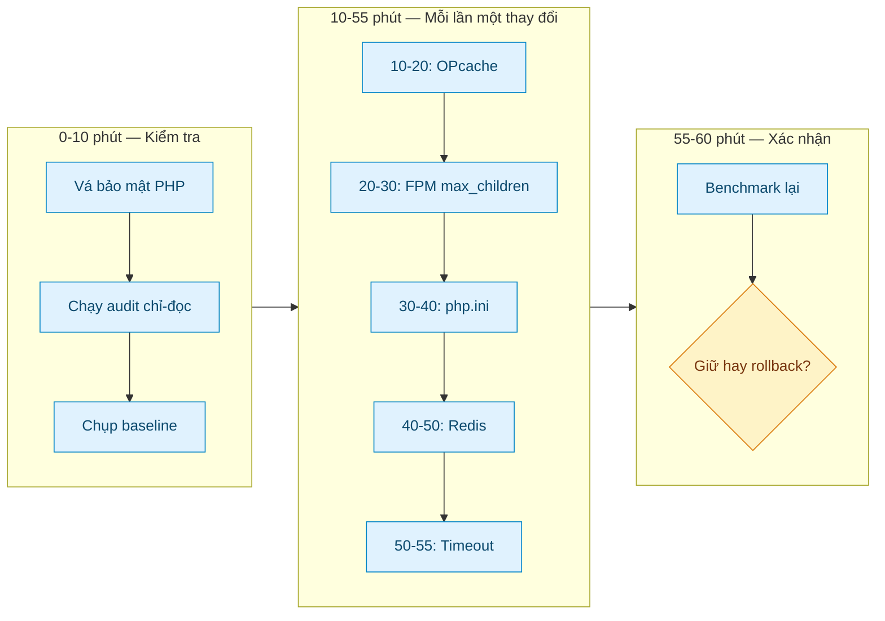

# Sơ đồ kiến trúc & luồng vận hành

Bộ sơ đồ cho playbook [tối ưu PHP trên DirectAdmin](../README.md). Tất cả vẽ bằng **Mermaid** — GitHub render thành hình ngay trong trang, không cần cài gì. Muốn sửa thì sửa text, không phải sửa ảnh.

| # | Sơ đồ | Trả lời câu hỏi |
|---|---|---|
| 1 | [Luồng request](#1-luồng-request-từ-trình-duyệt-đến-database) | Request đi qua những tầng nào? |
| 2 | [Nguồn và kết quả cấu hình](#2-nguồn-và-kết-quả-cấu-hình) | Sửa file nào thì không bị ghi đè? |
| 3 | [Pool PHP-FPM theo user](#3-pool-php-fpm-theo-user) | Vì sao 12 domain chia nhau 4 worker? |
| 4 | [Vòng đời worker `ondemand`](#4-vòng-đời-worker-ondemand) | Worker sinh ra và chết khi nào? |
| 5 | [OPcache nằm ở đâu](#5-opcache-nằm-ở-đâu) | Vì sao bật 4 phiên bản PHP lại tốn 1 GB RAM? |
| 6 | [Cây quyết định `max_children`](#6-cây-quyết-định-max_children) | Tính số worker theo RAM thế nào? |
| 7 | [Chuỗi timeout lồng nhau](#7-chuỗi-timeout-lồng-nhau) | Vì sao có 504 dù PHP vẫn đang chạy? |
| 8 | [Vòng lặp tối ưu](#8-vòng-lặp-tối-ưu) | Quy trình đo — đổi — đo — rollback |
| 9 | [Ba tầng cache](#9-ba-tầng-cache) | OPcache, Redis và page cache khác nhau ở đâu? |
| 10 | [Kế hoạch 60 phút](#10-kế-hoạch-60-phút) | Làm gì, theo thứ tự nào? |

---

## 1. Luồng request: từ trình duyệt đến database



Đọc sơ đồ này theo hai hướng:

- **Đi từ trái sang phải**: đó là đường đi của một request. Tầng nào cũng có timeout, buffer và giới hạn kích thước riêng.
- **Nhìn từ phải sang trái khi có lỗi**: 502/504 hiếm khi do tầng người dùng nhìn thấy. Nó thường do tầng **sau** đã chết hoặc đã cắt kết nối.

Nếu server dùng `nginx` thuần, bỏ nhánh Apache. Nếu dùng LiteSpeed/OpenLiteSpeed, thay `PHP-FPM` bằng `LSPHP` và bỏ Apache — cơ chế tính worker cũng khác, đừng áp công thức FPM.

---

## 2. Nguồn và kết quả cấu hình

Đây là sơ đồ quan trọng nhất để không mất công chỉnh sửa. DirectAdmin là hệ thống **sinh cấu hình từ template**: sửa nhầm phía "kết quả" thì lần `da build` tiếp theo sẽ xoá sạch.



Quy tắc rút ra:

- Cần bền qua rebuild → sửa **cột xanh**.
- Đã sửa cột đỏ và thấy mất sau `da build` → đó là hành vi đúng của hệ thống, không phải bug.
- `php.ini` nằm ở giữa: bền nếu `php_ini=no`, có thể bị ghi đè nếu `php_ini=yes`.

---

## 3. Pool PHP-FPM theo user

DirectAdmin sinh **một pool cho mỗi user, cho mỗi phiên bản PHP**. Không phải mỗi domain.



Ba điều sơ đồ này nói rõ:

1. **Tất cả domain của alice dùng chung 4 worker.** Một site bị crawl → 11 site còn lại xếp hàng.
2. **`max_children` là trần đồng thời, không phải số worker luôn chạy.** Với `ondemand`, lúc rảnh pool có 0 worker.
3. **OPcache dùng chung theo master**, không theo pool. Đây là lý do cách ly OPcache chỉ có được khi tách master (isolated FPM).

Muốn cách ly theo domain: tách tài khoản, hoặc bật isolated FPM (mỗi user một master, tốn thêm ~20 MB/user khi rảnh).

---

## 4. Vòng đời worker `ondemand`



Hai tham số quyết định vòng đời:

| Tham số | Mặc định DA | Ý nghĩa |
|---|---|---|
| `pm.process_idle_timeout` | `20` giây | Worker rảnh bao lâu thì bị đóng |
| `pm.max_requests` | `500` | Worker phục vụ bao nhiêu request thì tự tái sinh |

`max_requests` giới hạn rò rỉ bộ nhớ: worker chết định kỳ và sinh lại với bộ nhớ sạch. Đặt quá cao (10000) thì worker phình dần; quá thấp (50) thì spawn liên tục, tốn CPU.

Hệ quả của `ondemand`: request đầu tiên sau thời gian rảnh phải chờ spawn — thường 20–80 ms. Trên shared hosting, đây là đánh đổi đúng: tiết kiệm RAM hơn nhiều so với việc giữ worker thường trực cho 180 tài khoản ít traffic.

---

## 5. OPcache nằm ở đâu



Phép tính cần nhớ:

| Cấu hình | OPcache dùng |
|---|---|
| 1 phiên bản, shared pool | 256 MB |
| 3 phiên bản, shared pool | 3 × 256 MB = **768 MB** |
| 180 user, isolated FPM, 64 MB mỗi master | 180 × 64 MB = **11.5 GB** |

Dòng cuối là cái bẫy thật: bật isolated FPM rồi giữ nguyên OPcache 256 MB/user sẽ OOM ngay. Isolated FPM phải đi kèm giảm mạnh `opcache.memory_consumption` (32–64 MB) hoặc chỉ bật cho nhóm user thật sự cần.

---

## 6. Cây quyết định `max_children`



Lưu ý: nhánh "nhiều user" **không** có nghĩa là đặt 1 cho tất cả. Nó có nghĩa là mặc định thấp, rồi nâng riêng cho user thật sự cần — vì `max_children` là trần lý thuyết nhân với số pool.

---

## 7. Chuỗi timeout lồng nhau



Nguyên tắc: **tầng ngoài phải kiên nhẫn hơn tầng trong**. Nếu nginx cắt ở 30s trong khi PHP cần 50s, người dùng nhận 504, còn PHP vẫn chạy tiếp và vẫn chiếm worker — tệ nhất trong cả hai thế giới: khách thấy lỗi, server vẫn tải.

Một điểm dễ nhầm: `max_execution_time` tính **CPU time**, không phải thời gian thực. Request chờ MySQL 5 phút có thể không bị nó kill. Vì vậy cần thêm `request_terminate_timeout` của FPM (wall clock) làm lưới an toàn.

---

## 8. Vòng lặp tối ưu



Vòng lặp này giải thích vì sao "tối ưu một lần cho xong" không tồn tại: mỗi thay đổi cần một phép đo riêng, và mỗi phép đo cần thời gian để lộ vấn đề (10 phút cho lỗi rõ, 24 giờ cho xu hướng, 7 ngày cho rò rỉ bộ nhớ).

---

## 9. Ba tầng cache



| Tầng | Cache cái gì | Không cache được | Nếu tắt |
|---|---|---|---|
| Page cache | HTML cuối cùng | Trang đăng nhập, giỏ hàng | TTFB cao, CPU tăng |
| OPcache | Bytecode đã biên dịch | Kết quả query | CPU tăng mạnh, rõ nhất với WP |
| Object cache | Kết quả query/object | Toàn bộ trang | DB chịu tải lặp lại |
| Session store | Session id → dữ liệu | — | User mất đăng nhập khi scale ngang |

Ba tầng này **bổ sung**, không thay thế nhau. Một lỗi phổ biến: bật Redis object cache rồi tưởng đã có page cache, trong khi mỗi request vẫn chạy toàn bộ WordPress.

---

## 10. Kế hoạch 60 phút



Nếu server đông user, đừng nén tất cả vào 60 phút. Chia theo đêm: đêm 1 OPcache + FPM, đêm 2 php.ini, đêm 3 Redis. Mỗi đêm vẫn giữ nguyên tắc **một thay đổi, một phép đo**.

---

## Bản ASCII (đọc offline, không cần Mermaid)

```text
                        ┌──────────────┐
                        │  Người dùng  │
                        └──────┬───────┘
                               │
                        ┌──────▼───────┐
                        │  CDN / WAF   │
                        └──────┬───────┘
                               │
                        ┌──────▼───────┐        ┌──────────┐
                        │    nginx     │───────►│  NVMe    │
                        │ static+proxy │        │ file tĩnh│
                        └──────┬───────┘        └──────────┘
                               │ proxy 65s
                        ┌──────▼───────┐
                        │    Apache    │
                        └──────┬───────┘
                               │ fastcgi
                        ┌──────▼───────────────────────┐
                        │  PHP-FPM  (1 master/version) │
                        │  ┌────────┐ ┌────────┐       │
                        │  │ alice  │ │  bob   │  ...  │
                        │  │ max 4  │ │ max 4  │       │
                        │  └───┬────┘ └───┬────┘       │
                        │      └────┬─────┘            │
                        │      OPcache (shared)        │
                        └───────────┼──────────────────┘
                                    │
                     ┌──────────────┴──────────────┐
                     │                             │
              ┌──────▼───────┐             ┌───────▼──────┐
              │    MySQL     │             │    Redis     │
              │  (query)     │             │ object+session│
              └──────────────┘             └──────────────┘
```

---

> [!TIP]
> Khi trình bày sự cố với đồng nghiệp hoặc khách hàng, gửi kèm sơ đồ 1 và sơ đồ 3.
> Hai hình đó trả lời được 80% câu hỏi "vì sao web chậm / vì sao 502" mà không cần
> giải thích dài.
